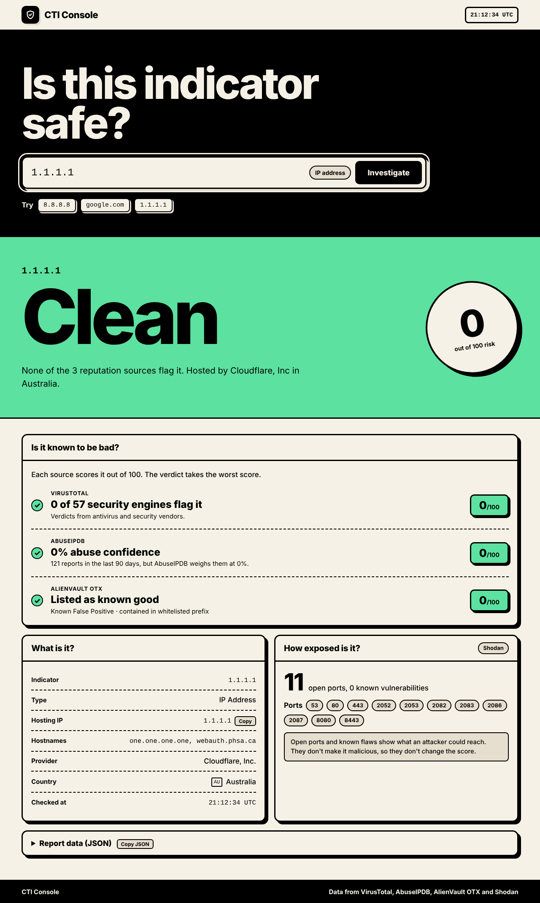
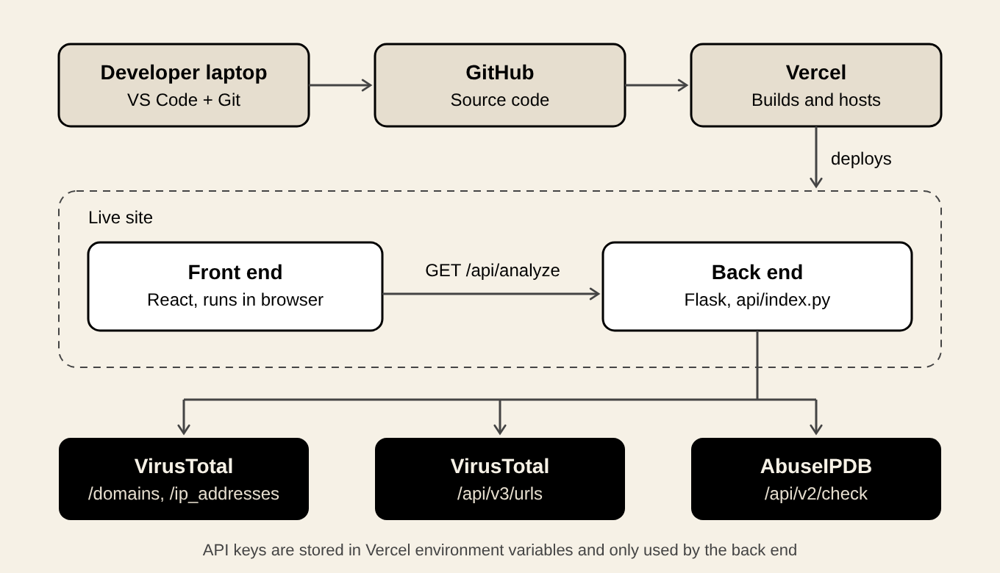

# CTI Console

A threat intelligence lookup tool. Paste a domain, URL or IP address and it checks four intelligence sources, then tells the user: "is it known to be bad, what is it, and how exposed is it?". Built as a first-pass triage tool for anyone investigating whether an indicator is malicious.

**Live:** https://cti-dashboard-tau.vercel.app

## What it does

- Accepts domains, full URLs, and IP addresses (IPv4 and IPv6)
- Returns a **risk score out of 100**, a verdict (Clean, Suspicious or High risk) and one sentence saying which sources flagged it and where it's hosted
- The results page answers the questions an analyst asks, in order:
  1. **Is it known to be bad?** VirusTotal, AbuseIPDB and AlienVault OTX, each with its own score out of 100 and a one-line reason
  2. **What is it?** The indicator, its type, hosting IP, hostnames, provider and country
  3. **How exposed is it?** Open ports, known vulnerabilities (CVEs) and tags from Shodan
- **Report data (JSON):** the combined report the verdict was built from, with a copy button so an analyst can paste it into a ticket

## How it works

The browser sends a GET request to my back end (`api/index.py`, running on Vercel). The back end sends its own requests to each intelligence source, combines the useful parts into one report, and sends that back to the browser, where React displays it.

- **IP searches** go to VirusTotal's `/ip_addresses` endpoint, AbuseIPDB, AlienVault OTX and Shodan InternetDB
- **Domain searches** go to VirusTotal's `/domains` endpoint and OTX. The IP from the domain's DNS records is then checked with AbuseIPDB and Shodan (one API's answer becomes the next API's question)
- **URL searches** also check VirusTotal's `/urls` endpoint and OTX's URL records, so the verdict reflects that exact page

## How the score works

Each reputation source scores the indicator out of 100. The verdict takes the **worst** score, so one credible alarm is enough to flag it.

| Source | What it measures | Score |
|---|---|---|
| VirusTotal | How many of 60+ security engines say malicious | 15 points per engine, capped at 100 |
| AbuseIPDB | Abuse reports from other networks | Its own confidence score (0 to 100) |
| AlienVault OTX | Community threat reports ("pulses") | 50 if linked to malware families, 25 if mentioned in reports, 0 if OTX lists it as known good |
| Shodan | Open ports and known vulnerabilities | **Not scored** |

Two design decisions worth calling out:

- **Exposure isn't the same as reputation:** Open ports and CVEs show what an attacker could reach, not whether the server itself is malicious. A bank's server can have a CVE. So Shodan adds context but never changes the score
- **Report counts can be misleading:** 1.1.1.1 (Cloudflare's DNS) has over 100 AbuseIPDB reports, but AbuseIPDB scores them at 0% and OTX lists it as a known false positive. The page explains that instead of raising an alarm on the raw count

## Tech stack

- **Front end:** React, built with Vite
- **Back end:** Python, Flask, `requests`
- **Hosting:** Vercel (static front end plus a serverless Python function)
- **Data sources:** VirusTotal API v3, AbuseIPDB API v2, AlienVault OTX API v1, Shodan InternetDB
- **Tools:** VS Code, Git and GitHub

## Threat model

What I'm protecting, and from what:

| Asset | Threat | Mitigation |
|---|---|---|
| API keys | Leaked through code, the browser or error messages | Stored in Vercel environment variables, only used server-side, never sent to the browser |
| API quota (VirusTotal free tier: 4 lookups a minute, 500 a day) | One visitor spamming searches and breaking the site for everyone | Per-visitor rate limiting |
| Visitors | Malicious input that runs in someone's browser (XSS) | React renders all input as text, the API only returns JSON, and nothing is stored |
| Verdict accuracy | A failed lookup being shown as "Clean" | The back end stops with a clear error when VirusTotal rate-limits it, and any source that fails shows "No result" rather than a score of 0 |

## Security decisions

- **Secrets stay on the server:** API keys live in Vercel environment variables, not in the code. The code only holds the variable names, so nothing sensitive is ever committed to GitHub
- **The front end never calls the intelligence sources directly:** Anything shipped to the browser is public, so a key there could be read by anyone through DevTools. The browser only talks to my back end
- **No information disclosure in errors:** Server errors are logged in full on Vercel, but visitors only ever see one generic message. Error details can reveal hostnames, paths and library versions to an attacker
- **Fail clearly:** If a required API key is missing, the back end stops with a logged config error instead of quietly sending a placeholder key
- **Fail closed for the verdict, degrade gracefully for context:** VirusTotal drives the verdict, so if it rate-limits the app, the back end returns a `503` rather than a misleading "Clean". Shodan and OTX are extra context, so if one times out or fails, the page shows a note for that source and everything else still works
- **Never paste user input into a URL raw:** IPs are validated before being used in an API address, and URLs are encoded with `quote()` before being sent to OTX
- **Per-visitor rate limiting:** Each IP gets 3 searches a minute, after which the back end returns `429 Too Many Requests` before any external API is called
- **No unnecessary CORS:** The front end and API share one origin, so cross-origin access is switched off. Other websites can't build on top of my API through their visitors' browsers
- **Only GET is allowed** on the API endpoint, since that's the only method it needs
- **Proper IP validation** using Python's built-in `ipaddress` module, which correctly handles IPv6

## Policies

- **[Security policy](SECURITY.md):** how to report a vulnerability privately, and what's in scope
- **[Acceptable use policy](ACCEPTABLE_USE.md):** what the tool may and may not be used for, and what to know before searching

## Interesting problems I solved

### A phishing page hiding on a "clean" domain

A domain called `dk-2026fifa.com` came back **Clean** on my dashboard. But when I checked VirusTotal directly, the full URL `https://dk-2026fifa.com/` had been flagged as **phishing** by one vendor.

**Why:** VirusTotal tracks domains and URLs as separate objects, each with its own verdict. A domain can look clean while one specific page on it is malicious, which is common with phishing. My app was stripping every URL down to its domain, so the page-level verdict was never checked.

**Fix:** the app now recognises full URLs and also queries VirusTotal's `/urls` endpoint. VirusTotal identifies URLs by a base64-encoded ID, so the back end encodes the URL first, and retries with a trailing slash if it isn't found (VirusTotal treats `site.com` and `site.com/` as different URLs). The dashboard also says whether the verdict came from the exact URL or fell back to the domain.

### Choosing a third reputation source

I planned to add GreyNoise, which is useful because it can *lower* suspicion by recognising harmless internet scanners. But its free tier allows only 10 lookups a day without a key, covers IPv4 only, and counts lookups by IP. Vercel sends requests from IPs shared with other apps, so the limit could be used up by strangers before my site even made a request.

I chose AlienVault OTX instead: a free key, coverage for IPs, domains and URLs, and a "known good" list that gives the same "calm down, this is normal" signal for well-known infrastructure.

### A page that contradicted itself

As I added sources, each one got its own panel. The page ended up showing the same numbers three times, and for 1.1.1.1 it said "no abuse reporter has flagged this" right above a tile reading "121 abuse reports". I redesigned it around the questions an analyst asks, gave every source the same row format, and made every colour on the page come from one scoring rule, so nothing can disagree with the verdict.

## Limitations and what's next

- **Shared rate limiting:** Counts are kept in memory per server instance. On serverless, instances don't share memory and reset when idle, so this is best effort. In production I'd move the counters to a shared store like Redis
- **Caching:** Repeat lookups of the same indicator could be cached for a few minutes, saving quota and making the site faster
- **"No data" verdict:** When no source has ever seen a brand-new indicator, the dashboard shows Clean. It should say "No data" instead, since brand-new malicious infrastructure often has no history
- **Server-side input validation:** The search bar checks input, but the API itself should also reject anything that isn't a valid IP, domain or URL, since front-end checks can be bypassed
- **Sequential lookups:** The back end calls each source one after another. Running them in parallel would make searches noticeably faster
- **Weighting sources by reliability:** The verdict takes the worst score, because a false alarm is cheaper than a missed threat. A more mature approach would weight each source by how reliable it is, like the Admiralty Code that intel teams use to grade sources, then tune those weights against known-good and known-bad indicators

## Running it yourself

1. Get free API keys from [VirusTotal](https://www.virustotal.com), [AbuseIPDB](https://www.abuseipdb.com) and [AlienVault OTX](https://otx.alienvault.com). Shodan InternetDB needs no key
2. Deploy to Vercel and add three environment variables: `VT_API_KEY`, `ABUSEIPDB_API_KEY` and `OTX_API_KEY`
3. To run locally: `pip install -r requirements.txt`, then `python api/index.py` for the back end, and `npm install` then `npm run dev` for the front end