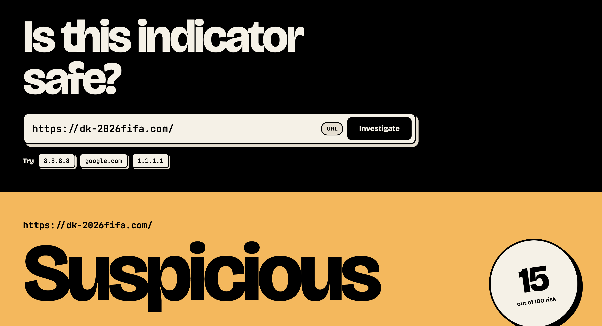

# CTI Console

A threat intelligence lookup tool. Paste a domain, URL or IP address and it checks VirusTotal and AbuseIPDB, then gives one risk verdict with the signals behind it. Built as a first-pass triage tool for anyone investigating whether an indicator is malicious.

**Live:** https://cti-dashboard-tau.vercel.app

## What it does

- Accepts domains, full URLs, and IP addresses (IPv4 and IPv6)
- Returns a **risk score out of 100** and a verdict: Clean, Suspicious or High risk
- **VirusTotal:** malicious vs harmless verdicts from 60+ security engines, plus the network provider
- **AbuseIPDB:** abuse confidence score, number of reports in the last 90 days, and hosting country
- **Target profile:** the indicator, its type, the IP it resolves to, provider and country
- **Why this verdict:** a plain-English breakdown of the signals behind the score
- **Raw API response:** the exact data the verdict was built from, so an analyst can check it or paste it into a ticket

## How it works

The browser sends a GET request to my back end (`api/index.py`, running on Vercel). The back end sends its own GET requests to the VirusTotal and AbuseIPDB APIs, gets their JSON replies, combines the useful parts into one report, and sends that back to the browser, where React displays it.

- **IP searches** go to VirusTotal's `/ip_addresses` endpoint and AbuseIPDB
- **Domain searches** go to VirusTotal's `/domains` endpoint. The IP from its DNS records is then checked with AbuseIPDB (one API's answer becomes the next API's question)
- **URL searches** also check VirusTotal's `/urls` endpoint, so the verdict reflects that exact page
- **The risk score** takes the worse of two signals: VirusTotal detections (15 points each, capped at 100) or the AbuseIPDB confidence score. One credible alarm is enough to flag it

## Tech stack

- **Front end:** React, built with Vite
- **Back end:** Python, Flask, `requests`
- **Hosting:** Vercel (static front end plus a serverless Python function)
- **Data sources:** VirusTotal API v3, AbuseIPDB API v2
- **Tools:** VS Code, Git and GitHub

## Threat model

What I'm protecting, and from what:

| Asset | Threat | Mitigation |
|---|---|---|
| API keys | Leaked through code, the browser or error messages | Stored in Vercel environment variables, only used server-side, never sent to the browser |
| API quota (VirusTotal free tier: 4 lookups a minute, 500 a day) | One visitor spamming searches and breaking the site for everyone | Per-visitor rate limiting |
| Visitors | Malicious input that runs in someone's browser (XSS) | React renders all input as text, the API only returns JSON, and nothing is stored |
| Verdict accuracy | A failed lookup being shown as "Clean" | The back end stops with a clear error when VirusTotal rate-limits it, instead of showing a result |

## Security decisions

- **Secrets stay on the server.** API keys live in Vercel environment variables, not in the code. The code only holds the variable names, so nothing sensitive is ever committed to GitHub
- **The front end never calls VirusTotal or AbuseIPDB directly.** Anything shipped to the browser is public, so a key there could be read by anyone through DevTools. The browser only talks to my back end
- **No information disclosure in errors.** Server errors are logged in full on Vercel, but visitors only ever see one generic message. Error details can reveal hostnames, paths and library versions to an attacker
- **Fail clearly, not silently.** If an API key is missing, the back end stops with a logged config error instead of quietly sending a placeholder key
- **Fail closed.** If VirusTotal rate-limits the app, it returns a `503` and tells the visitor to wait, rather than showing a misleading "Clean" verdict. "I don't know" should never look like "it's safe"
- **Per-visitor rate limiting.** Each IP gets 3 searches a minute, after which the back end returns `429 Too Many Requests` before any external API is called
- **No unnecessary CORS.** The front end and API share one origin, so cross-origin access is switched off. Other websites can't build on top of my API through their visitors' browsers
- **Only GET is allowed** on the API endpoint, since that's the only method it needs
- **Proper IP validation** using Python's built-in `ipaddress` module, which correctly handles IPv6

## Policies

- **[Security policy](SECURITY.md):** how to report a vulnerability privately, and what's in scope
- **[Acceptable use policy](ACCEPTABLE_USE.md):** what the tool may and may not be used for, and what to know before searching

## Interesting problem I solved

A domain called `dk-2026fifa.com` came back **Clean** on my dashboard. But when I checked VirusTotal directly, the full URL `https://dk-2026fifa.com/` had been flagged as **phishing** by one vendor.

**Why:** VirusTotal tracks domains and URLs as separate objects, each with its own verdict. A domain can look clean while one specific page on it is malicious, which is common with phishing. My app was stripping every URL down to its domain, so the page-level verdict was never checked.

**Fix:** the app now recognises full URLs and also queries VirusTotal's `/urls` endpoint. VirusTotal identifies URLs by a base64-encoded ID, so the back end encodes the URL first, and retries with a trailing slash if it isn't found (VirusTotal treats `site.com` and `site.com/` as different URLs). The dashboard also says whether the verdict came from the exact URL or fell back to the domain.

## Limitations and what's next

- **Shared rate limiting.** Counts are kept in memory per server instance. On serverless, instances don't share memory and reset when idle, so this is best effort. In production I'd move the counters to a shared store like Redis
- **Caching.** Repeat lookups of the same indicator could be cached for a few minutes, saving quota and making the site faster
- **"No data" verdict.** When VirusTotal has never seen a new domain, the dashboard currently shows Clean. It should say "No data" instead
- **Server-side input validation.** The search bar checks input, but the API itself should also reject anything that isn't a valid IP, domain or URL, since front-end checks can be bypassed
- **More sources.** Adding a third intelligence source would make the verdict more reliable

## Running it yourself

1. Get free API keys from [VirusTotal](https://www.virustotal.com) and [AbuseIPDB](https://www.abuseipdb.com)
2. Deploy to Vercel and add two environment variables: `VT_API_KEY` and `ABUSEIPDB_API_KEY`
3. To run locally: `pip install -r requirements.txt`, then `python api/index.py` for the back end, and `npm install` then `npm run dev` for the front end